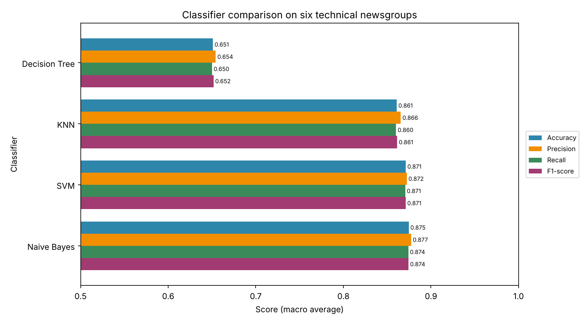
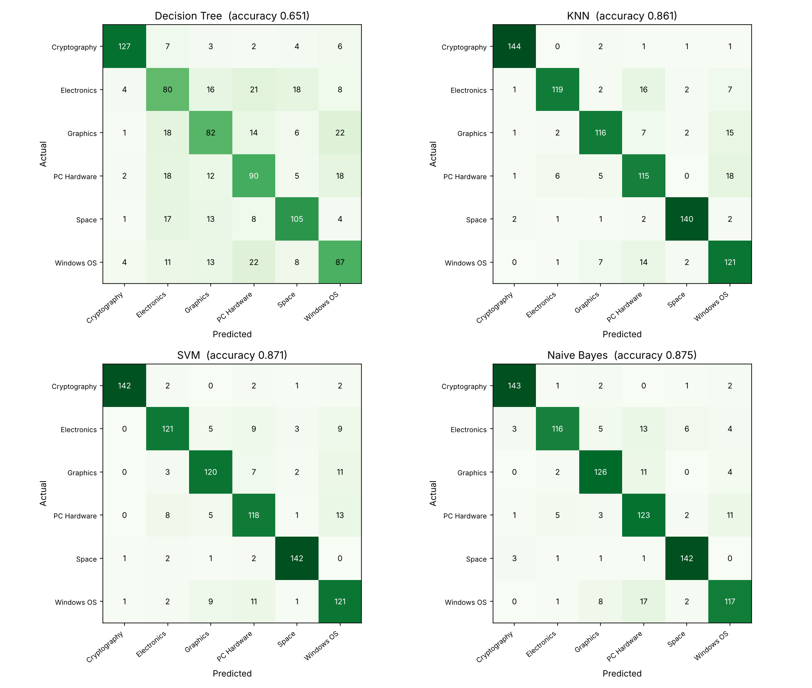
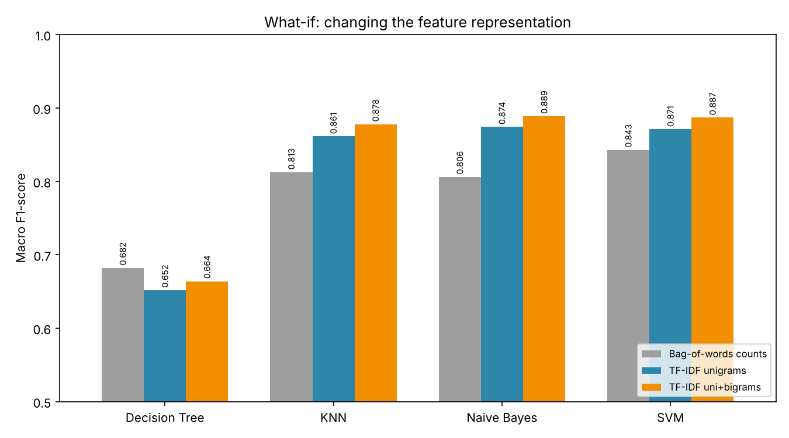

# IR Text Classification Assignment — Decision Tree vs KNN vs SVM vs Naïve Bayes

**Course:** Information Retrieval (21CSE377T), CLA-2 Task 2
**Student:** Harini K K (RA2411026050041), III Year CSE AIML A

This project follows on from the Task 1 TF-IDF search system, which used a collection of computing-topic documents. Here the same preprocessing and the same TF-IDF idea are used to build a classifier. The program decides which technical discussion group a post belongs to, and four algorithms are compared on the same data.

## Dataset

**20 Newsgroups** (K. Lang, 1995) is a standard IR benchmark of real Usenet discussion posts. For this project, six computing and science groups were taken from its training portion. These match the kind of topics covered in Task 1, such as cybersecurity, operating systems, hardware and graphics.

| Newsgroup | Class name | Posts used |
|---|---|---|
| sci.crypt | Cryptography | 595 |
| sci.space | Space | 591 |
| sci.electronics | Electronics | 587 |
| comp.sys.ibm.pc.hardware | PC Hardware | 581 |
| comp.os.ms-windows.misc | Windows OS | 579 |
| comp.graphics | Graphics | 574 |

Altogether 3,507 posts are used. The classes are nearly balanced, with a ratio of 1.04 between the largest and smallest. 37 posts were dropped because they were empty or duplicates.

## Method

1. **Cleaning:** each post has its e-mail header block (From, Organization, addresses), quoted replies and signature removed. These parts can give away the newsgroup without reading the message. Only the Subject line is kept.
2. **Preprocessing:** the same steps as Task 1, in order:
   - convert to lowercase
   - keep alphabetic tokens only
   - remove stop words
   - apply Porter stemming
3. **Split:** stratified 75/25, giving 2,630 posts for training and 877 for testing (`random_state=7`).
4. **Features:** TF-IDF with `min_df=3`, `max_df=0.9` and `sublinear_tf=True`, giving 6,218 terms. The vectorizer is fitted on the training posts only.
5. **Classifiers:** Decision Tree, KNN (k=10, cosine distance, distance-weighted votes), Linear SVM (C=1) and Multinomial Naïve Bayes (alpha=0.1).
6. **Evaluation:** accuracy, macro precision, recall and F1-score, a confusion matrix for each model, and per-class F1.
7. **What-if experiment:** the feature representation is changed. Bag-of-words counts, TF-IDF unigrams and TF-IDF unigrams+bigrams are compared.

## Results (877 test posts)

| Classifier | Accuracy | Precision | Recall | F1-score |
|---|---|---|---|---|
| Decision Tree | 0.6511 | 0.6543 | 0.6500 | 0.6518 |
| KNN | 0.8609 | 0.8655 | 0.8601 | 0.8614 |
| SVM | 0.8712 | 0.8724 | 0.8705 | 0.8710 |
| **Naïve Bayes** | **0.8746** | **0.8774** | **0.8741** | **0.8742** |

**What-if result (macro F1):**

| Classifier | Bag-of-words counts | TF-IDF unigrams | TF-IDF uni+bigrams |
|---|---|---|---|
| Decision Tree | 0.6823 | 0.6518 | 0.6640 |
| KNN | 0.8127 | 0.8614 | 0.8779 |
| Naïve Bayes | 0.8062 | 0.8742 | **0.8888** |
| SVM | 0.8427 | 0.8710 | 0.8868 |





## Run

```bash
pip install -r requirements.txt
python text_classification.py
```

All tables are written to `outputs/` and all graphs to `plots/`.

## Files

```
text_classification.py      main program
dataset/tech_newsgroups.csv the six newsgroups used (raw posts)
outputs/                    result tables, confusion matrices, console output
plots/                      graphs
report/                     assignment document (PDF + DOCX)
```

## Reference

K. Lang, "NewsWeeder: Learning to Filter Netnews," *Proc. 12th International Conference on Machine Learning*, 1995.
